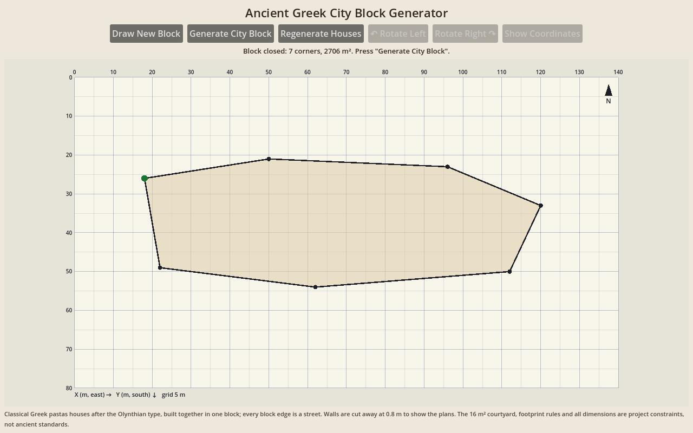
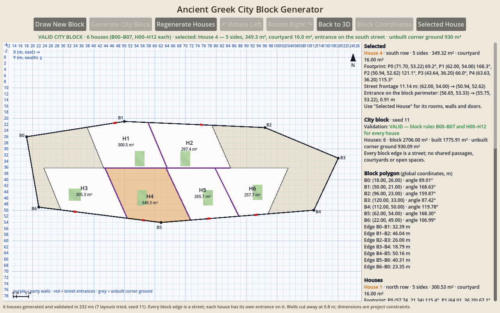

# Ancient Greek City Block Generator (Godot 4 prototype)

Draw the outline of a city block; the generator subdivides it into **5 or 6
plots** and builds a Classical Greek courtyard house of the **Olynthian pastas
type** on each one. All houses are shown together in one interactive **3D
cutaway** of the block, and a **coordinate schematic** shows the block and the
selected house with exact coordinates.

Every house passes the house rules H00–H12 (4–6-sided footprint, no corner
between 80° and 110°, its own 16 m² courtyard, a northern east–west wing, a
pastas, its own entrance straight onto a street with ≥ 2.0 m of frontage) and
the whole block passes the block rules B00–B07 (5 or 6 houses, all inside the
block, no overlaps, no shared spaces or courtyards, every entrance on the block
perimeter, one shared north). A block is shown only when **all** of that holds;
otherwise the app reports why generation failed and shows no houses.


## Using the app

1. **Draw the block.** The app starts with an empty drawing area (metre grid,
   X east, Y south, north up) and a dashed guide of a block size that works
   well. Click to place corners (snapped to 5 cm); click the first corner
   again to close the outline. Right-click or Backspace removes the last
   corner; a corner that would make the outline cross itself is refused. The
   closed outline is checked: at least 3 corners, edges ≥ 1 m, not
   self-intersecting, area ≥ 600 m².
2. **Generate City Block** subdivides the outline into 6 plots (5 if 6 cannot
   be fitted), builds and validates a house on every plot, validates the whole
   block and shows it in 3D. The info line reads **VALID CITY BLOCK** only when
   the block passed every check; on failure it reads **GENERATION FAILED** with
   the most common reasons, and nothing is shown.
3. **Click a house** (in 3D or in the block schematic) to select it: it gets an
   orange outline and room labels; all other houses stay visible.
4. **↶ Rotate Left / Rotate Right ↷** orbit the camera 45° around the centre of
   the block. The model is never rebuilt by rotation or selection.
5. **Show Coordinates** opens the coordinate schematic with two levels:
   **Block Coordinates** (block vertices B0…, edge lengths and angles, every
   house footprint with global coordinates, plot/party-wall lines, entrances on
   the perimeter, unbuilt ground) and **Selected House** (rooms, walls, doors,
   vertices in global and local coordinates). **Back to 3D** returns.
6. **Regenerate Houses** builds a new block of houses in the same outline.
   **Draw New Block** clears everything and starts a new outline.





## Running

- Open the folder in **Godot 4.3+** and press Play (main scene: `scenes/main.tscn`).
- Headless smoke test (exits 1 on failure):

  ```sh
  godot --headless --path . --script res://tests/smoke_test.gd </dev/null
  ```

  City block: generates blocks on five fixed outlines (covering 5 and 6
  houses) and re-checks every house and the block independently from the
  geometry (sides, H11 angles, containment, overlaps, 16 m² courtyards,
  entrances on the perimeter, frontage, wing north of the courtyard), runs the
  validators, checks that an outline too small for 5 houses fails with a
  reason, runs negative block checks (4 and 7 houses, overlap, house outside
  the block, entrances off the perimeter, a communal courtyard, a courtyard
  reaching into a neighbour, a rotated house), checks the 3D block model (every
  house's floors and walls, picking by click, selection and rotation never
  rebuild) and the block schematic, and drives the UI: drawing by clicks,
  closing on the first corner, generating, selecting, rotating, switching views
  without regenerating, regenerating in the same outline, and a failing outline.
  It also keeps the single-house checks (standalone generator, house validator
  negative checks, 3D meshes and schematic vs. data). Headless Godot 4.3 prints
  `Parameter "m" is null` when ArrayMeshes are freed; that is a dummy-renderer
  quirk, not a test failure.

## Layout

| File | Role |
|---|---|
| `scripts/block_draw_view.gd` | Drawing canvas (`_draw()`): click corners, close on the first corner, then the block's footprints. |
| `scripts/block_generator.gd` | `generate_block(polygon, seed)`: subdivides the block into plots, builds a house per plot, validates; tries 6 then 5 houses; bounded attempts. |
| `scripts/block_validator.gd` | `validate_block(block) -> {valid, errors, residual_area}`: B00–B07 plus H00–H12 for every house. |
| `scripts/house_generator.gd` | `build_in_plot(rng, footprint, block, kind)` builds a house filling a plot; the older standalone `generate_valid_house` (max 10 attempts) is kept for tests. |
| `scripts/house_validator.gd` | `validate_house(house) -> {valid, errors, sides}`; explicit checks for H00–H12 and all prototype dimensions. |
| `scripts/geometry.gd` | Shared measurements used by the validators and every view: shoelace area, edge lengths, interior angles, point-in-polygon, global→local, world→screen. |
| `scripts/house_3d_view.gd` | `SubViewportContainer` with its own 3D world: one model of the whole block, selection overlay, camera orbit, picking. |
| `scripts/house_schematic_view.gd` | Coordinate schematic (`_draw()`): block level and selected-house level, picking, scrollable inspection panel. |
| `scripts/main.gd` | UI workflow: draw → generate → 3D / coordinates; selection, rotation, regeneration. |
| `tests/smoke_test.gd` | Headless smoke test. |

## City block generation

Every edge of the drawn polygon is a public street. The block is one
geometry model: `{polygon, houses, plots, seed, validation}`, and each house is
the same house Dictionary as before, in the block's global coordinates (no
house is rotated or translated afterwards, so all houses share one north).

1. **Depth profile.** The street-to-street depth is sampled every 1.5 m
   across the block.
2. **Rows.** Either one row of "through" plots (block 13.5–20.5 m deep, streets
   on both sides), or an east–west **row line** on the 5 cm grid splitting the
   block into a **north row** (9.2–16 m deep) and a **south row** (11.6–18.5 m),
   i.e. a block about 21–34 m deep. Houses are built only along the longest
   stretch where every house fits; the block's pointed or too-deep ends outside
   it stay **unbuilt corner ground** (reported in m², drawn grey).
3. **Party walls.** Each row is cut into plots 12.5–22 m wide by straight party
   walls tilted 22–42° from north–south (a vertical party wall would make 90°
   corners, which H11 forbids); the outermost plots are closed by end walls
   that cut off unusable block corners. Plots must have 4–6 sides, no corner in
   [80°, 110°], no corner below 46°, edges ≥ 1.5 m, and be ≥ 11 m wide.
   Neighbouring plots share the party-wall line exactly; north and south rows
   share the row line.
4. **Houses.** Each plot is filled by `build_in_plot`:
   - **south row / one row**: party wall (or street) on the north, street on
     the south: wing, pastas, courtyard band, then a street range with the
     entrance passage onto the south street;
   - **north row**: street on the north, party wall on the south: the entrance
     passage runs through the wing from the north street to the pastas, and
     the courtyard backs onto the row line.
   The same layout rules as the standalone houses apply (16 m² courtyard,
   pastas 1.5–2.5 m, 4–9 rooms, walls 0.50/0.25 m); spaces and walls are clipped
   to the plot's interior polygon, never the courtyard, entrance passage or doors.
   Up to 10 layouts are tried per plot.
5. **Validation.** Every house is validated (H00–H12, with the street frontage
   measured on the block boundary) and then the whole block (B00–B07). Up to 30
   subdivisions are tried for 6 houses, then 30 for 5; if none passes, the
   generator fails with a summary of the most common reasons.

Generation is deterministic for a given outline and seed and usually takes
0.05–1 s. On 40 random, roughly rectangular blocks of 70–105 × 24–34 m, about
60 % produced a valid block (most with 6 houses); round, pointed, very small or
deeper blocks (more than about 34 m north–south) usually fail with a clear
reason. Blocks with long sides running east–west work best.

## Block rules (enforced in `block_validator.gd`)

| Rule | Checked numerically |
|---|---|
| B00 | The block polygon is simple with positive area. |
| B01 | Exactly 5 or 6 houses. |
| B02 | Every house footprint lies inside the block polygon (clipping, 0.01 m² tolerance). |
| B03 | No two footprints overlap (shared party-wall lines are allowed). |
| B04 | No shared spaces: the block defines no spaces, walls or openings of its own; no space of one house reaches into another. |
| B05 | Every house has an entrance whose outer face lies on the block perimeter, on ≥ 2.0 m of continuous frontage, measured against this block's streets. |
| B06 | Every courtyard is private: inside its own house, reaching into no other. |
| B07 | One shared north: no house is rotated; with H02 every northern wing lies north of its courtyard. |

Each house error is reported as `House N · H…`, so a block with one bad house
is invalid as a whole.

## House geometry model

- Metres; X grows east, Y grows south, north is up. Everything inside the
  house is axis-aligned; only the exterior footprint has slanted sides.
- **Footprint**: a polygon (`PackedVector2Array`). The exterior wall band is
  the footprint minus its 0.50 m inset (mitred); it is stored as one quad per
  side, the street side split around the entrance gap. In a block, a house's
  exterior walls along a party-wall line meet the neighbour's: together they
  form the party wall.
- **Spaces** (rooms, courtyard, pastas, entrance passage) are clear interior
  rectangles. **Walls** are separate rectangles (exterior 0.50 m, interior
  0.25 m). **Door openings** are rectangles cut out of a wall line, so the wall
  really has a gap. The pastas–courtyard boundary is a zero-thickness open
  edge (no wall).
- Where a slanted exterior wall trims a room, the pastas or an interior wall,
  the item carries its exact `poly` (its `rect` is then the bounding box) and
  its area is the polygon area. The courtyard, entrance passage and all door
  gaps are never trimmed.
- Spaces + walls + door gaps tile the footprint polygon exactly; the validator
  checks this (no overlaps, no gaps), so courtyard and room areas never include walls.
- Circulation is a graph: nodes are spaces plus the street; an edge exists only
  for an opening whose rectangle sits flush between the two spaces it joins.

## Standalone footprints (rules H00 and H11)

In a block, the footprint is the plot (4–6 sides from the block outline and
the tilted party walls). The standalone generator, kept for testing, makes its
own footprints:

The north face (the wing's back wall) and the south face (the street front
with the entrance) stay horizontal. Because a corner between a horizontal and
a vertical side is 90°, which H11 forbids, both east and west sides are slanted:

| Side type | Geometry | Corners |
|---|---|---|
| slant | one straight side tilted 21.5–24° from north–south | 90° ± tilt → about 111–114° and 66–69° |
| vee | two sides meeting at an inward point, tilted ≥ 12° (steeper half ≤ 28°) | 90° − tilt → at most 78°; the point is reflex (> 200°) |

| Sides | Combination | Shapes |
|---|---|---|
| 4 | slant + slant | trapezoid (narrower to the north or south) or rhomboid |
| 5 | vee + slant | pentagon with one waisted side |
| 6 | vee + vee | waisted hexagon |

A straight side between two parallel edges always makes one acute and one
obtuse corner (they sum to 180°), so a single slant needs more than 20° of
tilt; a vee only needs more than 10°, which keeps the cut small. The vee point
is placed on an east–west wall line (wing wall or pastas south wall), so no
room becomes concave.

The orthogonal layout is sized so the outermost rooms (wing end rooms, side
strips) keep at least 2.5 m clear of the slanted walls; then every space and
interior wall is clipped to the interior polygon. Trimmed rooms must stay
convex, keep ≥ 60 % of their bounding box, have no corner below 45° and be at
least 2.0 m wide in every direction (rotating-calipers width).

H00 is checked on the polygon itself: at least 3 vertices, no zero-length
edges (including a repeated closing vertex), no collinear consecutive edges,
positive area, no intersections between non-adjacent edges, and 4–6 sides.
H11 recomputes every interior angle (reflex angles included) and rejects any
in [80°, 110°], inclusive.

## Standalone house generation (construction by constraints)

1. Choose 4, 5 or 6 sides (seeded) and a courtyard of exactly 16 m² (4×4, 3.2×5 or 5×3.2 m).
2. Pick depths for the northern wing (3.0–4.5 m) and pastas (1.5–2.5 m).
3. Choose the east and west side types and measure how far each slanted wall
   intrudes over the wing band and the southern band.
4. Lay out the southern zone as west→east strips: side-room strip, courtyard
   and entrance passage (either order), side-room strip; the strips are
   widened by the intrusion. The courtyard sits directly under the pastas and
   runs to the south wall.
5. Choose a room count (4–9) that fits, lowering it if needed; partition the
   wing (end rooms widened by the intrusion) with full-depth partitions; split
   side strips into one or two rooms.
6. Build the footprint polygon and its interior polygon.
7. Add doors (north rooms → pastas; side rooms → courtyard/passage or pastas;
   passage → courtyard; street → passage), keeping doors clear of slanted walls,
   then cut them out of the walls.
8. Clip spaces and walls to the interior polygon; build the mitred exterior band.
9. Validate. Only a house with zero errors is returned.


## Hard rules (enforced in `house_validator.gd`)

All quantities are derived from geometry, not metadata: areas from the
shapes, the side count and angles from the polygon, the northern wing from the
rooms lying north of the pastas, access from opening positions, containment by
polygon clipping against the actual footprint.

| Rule | Checked numerically |
|---|---|
| H00 | Footprint polygon: simple, closed, positive area, no zero-length or collinear edges, 4–6 sides. |
| H01 | Exactly one courtyard, an unclipped rectangle; `w*d = 16.0 ± 0.001 m²`; inside the footprint; nothing overlaps it. |
| H02 | Wing = bounding box of the rooms (and a wing entrance passage) north of the pastas: `width > depth`, `bottom <= pastas.top`, north of the courtyard, rooms inside the footprint; at least one wing room opens to the pastas. |
| H03 | `courtyard.center_y >` footprint bounding-box `center_y`; courtyard's north edge flush with the pastas. |
| H04 | One pastas, depth 1.5–2.5 m, E–W axis, directly north of the courtyard, verified open edge to the courtyard with no wall across it, door to a north room; if trimmed, still convex without spiky corners. |
| H05 | Positive sizes; everything inside the footprint polygon; spaces inside the exterior wall band; no pairwise overlaps; area of spaces+walls+gaps = footprint area. |
| H06 | Interior walls 0.25 m; exterior walls lie in, and exactly fill, the 0.50 m band; rooms ≥ 2.0 m wide, ≥ 5.0 m², clear span ≤ 5.0 m; doors ≥ 0.80 m; every door is a gap flanked by the same wall line; trimmed rooms convex, corners ≥ 45°, ≥ 60 % of their box. |
| H07 | Every opening verified geometrically; BFS from the street reaches every space. |
| H08 | Valid entrance whose outer face lies on an edge of the footprint polygon facing the house's street side (south, or north for north-row houses), into a passage that leads via the pastas or directly to the courtyard; not blocked; courtyard reachable. |
| H09 | 4–9 rooms; known function; every room opens directly onto pastas, courtyard or passage. |
| H10 | North-wing rooms span the full wing depth (aligned E–W divisions) and the wing (within the interior) = rooms + N–S partitions; every interior wall end meets another wall, a door gap or the exterior wall band, or ends as an anta on the pastas line; all interior walls connect to the exterior band. |
| H11 | No interior angle of the footprint in [80°, 110°]. |
| H12 | A verified entrance opens directly onto the street frontage: a footprint edge on a street (in a block, an edge lying on the block boundary). |
| H12.1 | That frontage is one continuous edge at least 2.0 m long. |

## 3D view

`house_3d_view.gd` turns the validated block (every house Dictionary in it)
into one model; it refuses any block or house without a passing validation result.

- **Floors**: one flat mesh per space (rectangle or exact clipped polygon,
  triangulated), coloured by room function; courtyard in light earth/stone;
  pastas as its own darker floor with a dark line marking its open roof edge;
  door and entrance gaps get their own floor patches.
- **Walls**: one solid per wall record, 0.8 m tall — `BoxMesh` for rectangular
  pieces, an extruded prism for mitred exterior quads and trimmed interior
  walls. Door gaps stay open because walls exist only where the data has
  wall pieces; nothing is added (no roofs, no extra walls).
- **Block**: the block polygon as a slightly darker ground slab (unbuilt corner
  ground shows through), the streets around it as ground, a "House N" label
  per house.
- **Markers**: north arrow and "N" north of the block, entrance arrow on the
  street, billboard room labels for the selected house.
- **Selection**: an orange outline on the selected house's walls and its room
  labels live in a separate overlay; selecting rebuilds only the overlay.
  Clicking the 3D view casts a ray onto the ground and selects the house
  whose footprint contains the hit point.
- **Camera**: perspective, 55° elevation, orbiting the block centre, framed so
  the whole block fits at any rotation; plan (x, y) maps to 3D (x, 0, y),
  north is −Z.
- Only the current block's meshes exist; materials are shared; no physics.

The 0.8 m wall height is a cutaway height for visibility, **not** a claim about
ancient wall heights, and the pastas is shown without its roof.

For single houses the smoke test reads the vertices back from the generated meshes and checks
that each floor matches its space's area and extent (courtyard exactly
16 m²), that there is exactly one wall mesh per validated wall with the same
footprint and 0.8 m height, that every footprint corner is a corner of the
exterior wall meshes, that no wall mesh covers a door or entrance gap, and that
floors + gaps + walls cover exactly the footprint area.

## Coordinate schematic

**Block Coordinates** draws the block polygon with vertices `B0, B1, …` (global
coordinates, angles, edge lengths), every house footprint `H1…` with its area
and courtyard, party walls (purple), entrances on the perimeter (red) and the
unbuilt corner ground (grey); the panel lists the block, every house (footprint
vertices and angles, frontage, entrance segment) and every party wall. Clicking
a house selects it.

**Selected House** draws a technical plan of the selected house:

- X/Y rulers and a metre grid (major lines every 5 m), axis labels, scale bar, north arrow.
- The exterior footprint with every vertex labelled `P0, P1, …` and its
  coordinates, the length of every edge, and the interior angle at every
  vertex (red if it would break H11 — never the case for a displayed house).
- Rooms, courtyard (green, hatched), pastas (ochre, hatched) and entrance
  passage as outlines with ID, name and area; walls as filled shapes with their
  real thickness; door openings as red dimension lines `D#` across the real gap;
  the pastas–courtyard open edge dashed.
- An inspection panel (beside the drawing, or below it on narrow screens,
  scrollable) listing house data (validation status, sides, footprint and
  courtyard areas, room count, street frontage), every vertex in global and
  local coordinates, edge lengths, angles, every space (rectangle corners and
  width × depth, or all vertices for trimmed rooms with their shoelace area),
  the pastas' depth and relation to courtyard and wing, every door/opening
  (end points, width, wall thickness) and every wall (centreline start → end,
  length, thickness).
- Click a room, the courtyard or the pastas to highlight it and show its data at
  the top of the panel; clicking a wall or an exterior vertex works too.
- Numbers are shown to two decimals; the data keeps full precision.

There is one geometry model: the house Dictionary produced by the generator.
The validators, the drawing canvas, the 3D view and the schematic all read it, and all
measurements come from `geometry.gd`. **Global** coordinates are the data's
own (X east, Y south, metres). **Local** coordinates are the same points
translated so the house footprint's bounding-box top-left corner is (0, 0). The schematic is built once per house and only redrawn
when the selection or window size changes; no nodes are created per vertex or
wall.

## What is historical, what is a project rule, what is an assumption

**Archaeological evidence (Olynthos, c. 430–348 BCE).** Houses on the North
Hill were laid out in regular blocks; a typical house was entered from the
street, organised around a courtyard in the southern part, with a broad covered
portico (*pastas*) on the north side of the court opening south, and a range of
rooms behind it. Rooms opened mainly onto the court and pastas. Some houses had
an *andron* (dining room), often recognisable by an off-centre door and raised
couch border, and frequently placed near the street; many had a kitchen/hearth
room (*oikos*) in the northern range. See the
[Olynthos Project](https://sites.lsa.umich.edu/olynthos-project/olynthian-houses/)
and [House A vii 4](https://perseus-aa.github.io/items/aa_398.html). Olynthian
houses were typically much larger (around 17 × 17 m) with larger courtyards than
this prototype produces. Olynthian blocks on the North Hill were long
rectangles (about 86 × 35 m) split by a narrow east–west alley into two rows of
five houses; this prototype's blocks have no alley (the brief forbids shared
passages), so the row line is a party wall.

**Project-specific mandatory constraints.** The 16 m² courtyard, the pastas
depth range, the 4–9 room count, the 4–6-sided footprints without corners
between 80° and 110°, the 2.0 m street frontage, 5 or 6 houses per block with
every block edge a street, and the H00–H12 and B00–B07 rules are requirements
of this project, not ancient standards. Olynthian houses within a block were
mostly near-rectangular; the slanted and waisted footprints are project
variations (irregular plots did occur in Greek towns, but these shapes are not
modelled on particular houses).

**Simplified engineering assumptions.** Wall thicknesses (0.50/0.25 m), minimum
room width/area, 5 m maximum clear span, 0.80 m minimum door, axis-aligned
rectangles inside the house, the side tilts, the anti-sliver limits for trimmed
rooms (45° corners, 60 % fill), the subdivision parameters (row depths,
plot widths 12.5–22 m, party-wall tilt 22–42°), leaving block corners unbuilt,
the 5 cm construction grid, the wall-alignment
test standing in for structural analysis, and the 0.8 m cutaway wall height in
3D. Room functions are illustrative labels.

Scope: version 1 models only the later Classical pastas house. It does not
represent all Greek houses of 550–350 BCE (e.g. prostas houses, irregular or
rural houses).
