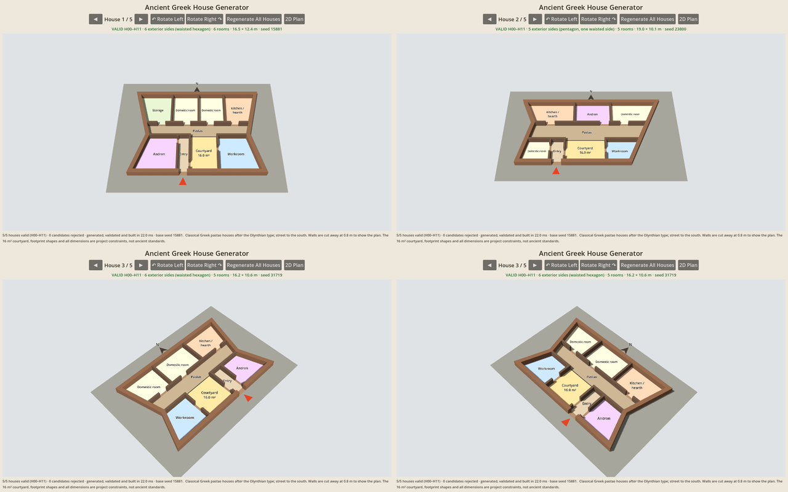

# Ancient Greek House Generator (Godot 4 prototype)

Generates Classical Greek courtyard houses of the **Olynthian pastas type** and
shows the selected house as an interactive **3D cutaway** (or as a 2D plan).
Every footprint has 4, 5 or 6 sides with no corner between 80° and 110°.
Every house shown has passed the hard-rule validator (H00–H11). If a slot
cannot produce a valid house within 10 candidates, it shows a generation error
and never shows an invalid house.



## Using the app

- On startup five different houses are generated, validated and stored; house 1 is shown in 3D.
- **◀ / ▶** show the previous / next stored house and wrap (5 → 1, 1 → 5).
  Navigation never generates anything: it selects a stored house, clears the
  previous 3D model and builds the selected house's model from its data.
- **↶ Rotate Left / Rotate Right ↷** orbit the camera 45° around the house
  centre (animated over 0.2 s). Rotate Left turns the house counter-clockwise
  on screen. Distance, elevation and focal point stay the same; the model is
  never rebuilt by rotation.
- **Regenerate All Houses** generates and validates five new houses (guaranteed
  different from the previous set), replaces the stored set and returns to house 1.
- **2D Plan / 3D View** switches the stage between the 3D view and the
  original plan drawing of the same stored house.
- The info line shows VALID H00–H11, the number of exterior sides as computed
  by the validator from the polygon, the shape, room count and size.
- Both views fit the house to the available area without distortion and follow
  window resizing; the button row wraps on narrow windows.

## Running

- Open the folder in **Godot 4.3+** and press Play (main scene: `scenes/main.tscn`).
- Headless smoke test (exits 1 on failure):

  ```sh
  godot --headless --path . --script res://tests/smoke_test.gd </dev/null
  ```

  It generates seeded 4/5/6-sided houses and re-validates them (side count and
  corner angles recomputed from the polygon), runs negative validator checks,
  compares the 3D meshes against the house data, and checks rotation,
  navigation and regeneration. (Headless Godot 4.3 prints
  `Parameter "m" is null` when ArrayMeshes are freed; that is a dummy-renderer
  quirk, not a test failure.)

## Layout

| File | Role |
|---|---|
| `scripts/house_generator.gd` | Builds candidates by construction, then calls the validator; bounded retries (max 10). |
| `scripts/house_validator.gd` | `validate_house(house) -> {valid, errors, sides}`; explicit checks for H00–H11 and all prototype dimensions. |
| `scripts/house_3d_view.gd` | `SubViewportContainer` with its own 3D world: meshes for the selected house only, camera orbit. |
| `scripts/house_view.gd` | 2D plan (`_draw()`), also used for the generation-error panel. Reads data only. |
| `scripts/main.gd` | UI: navigation, rotation, regeneration, 2D/3D toggle; stores the five results. |
| `tests/smoke_test.gd` | Headless smoke test. |

## Geometry model

- Metres; X grows east, Y grows south, north is up. Everything inside the
  house is axis-aligned; only the exterior footprint has slanted sides.
- **Footprint**: a polygon (`PackedVector2Array`). The exterior wall band is
  the footprint minus its 0.50 m inset (mitred); it is stored as one quad per
  side, the south side split around the entrance gap.
- **Spaces** (rooms, courtyard, pastas, entrance passage) are clear interior
  rectangles. **Walls** are separate rectangles (exterior 0.50 m, interior
  0.25 m). **Door openings** are rectangles cut out of a wall line, so the wall
  really has a gap. The pastas–courtyard boundary is a zero-thickness open
  edge (no wall).
- Where a slanted exterior wall trims a room, the pastas or an interior wall,
  the item carries its exact `poly` (its `rect` is then the bounding box) and
  its area is the polygon area. The courtyard, entrance passage and all door
  gaps are never trimmed.
- Spaces + walls + door gaps tile the footprint polygon exactly; the validator
  checks this (no overlaps, no gaps), so courtyard and room areas never include walls.
- Circulation is a graph: nodes are spaces plus the street; an edge exists only
  for an opening whose rectangle sits flush between the two spaces it joins.

## Footprints (rules H00 and H11)

The north face (the wing's back wall) and the south face (the street front
with the entrance) stay horizontal. Because a corner between a horizontal and
a vertical side is 90°, which H11 forbids, both east and west sides are slanted:

| Side type | Geometry | Corners |
|---|---|---|
| slant | one straight side tilted 21.5–24° from north–south | 90° ± tilt → about 111–114° and 66–69° |
| vee | two sides meeting at an inward point, tilted ≥ 12° (steeper half ≤ 28°) | 90° − tilt → at most 78°; the point is reflex (> 200°) |

| Sides | Combination | Shapes |
|---|---|---|
| 4 | slant + slant | trapezoid (narrower to the north or south) or rhomboid |
| 5 | vee + slant | pentagon with one waisted side |
| 6 | vee + vee | waisted hexagon |

A straight side between two parallel edges always makes one acute and one
obtuse corner (they sum to 180°), so a single slant needs more than 20° of
tilt; a vee only needs more than 10°, which keeps the cut small. The vee point
is placed on an east–west wall line (wing wall or pastas south wall), so no
room becomes concave.

The orthogonal layout is sized so the outermost rooms (wing end rooms, side
strips) keep at least 2.5 m clear of the slanted walls; then every space and
interior wall is clipped to the interior polygon. Trimmed rooms must stay
convex, keep ≥ 75 % of their bounding box, have no corner below 60° and be at
least 2.0 m wide in every direction (rotating-calipers width).

H00 is checked on the polygon itself: at least 3 vertices, no zero-length
edges (including a repeated closing vertex), no collinear consecutive edges,
positive area, no intersections between non-adjacent edges, and 4–6 sides.
H11 recomputes every interior angle (reflex angles included) and rejects any
in [80°, 110°], inclusive.

## Generation (construction by constraints)

1. Choose 4, 5 or 6 sides (seeded) and a courtyard of exactly 16 m² (4×4, 3.2×5 or 5×3.2 m).
2. Pick depths for the northern wing (3.0–4.5 m) and pastas (1.5–2.5 m).
3. Choose the east and west side types and measure how far each slanted wall
   intrudes over the wing band and the southern band.
4. Lay out the southern zone as west→east strips: side-room strip, courtyard
   and entrance passage (either order), side-room strip; the strips are
   widened by the intrusion. The courtyard sits directly under the pastas and
   runs to the south wall.
5. Choose a room count (4–9) that fits, lowering it if needed; partition the
   wing (end rooms widened by the intrusion) with full-depth partitions; split
   side strips into one or two rooms.
6. Build the footprint polygon and its interior polygon.
7. Add doors (north rooms → pastas; side rooms → courtyard/passage or pastas;
   passage → courtyard; street → passage), keeping doors clear of slanted walls,
   then cut them out of the walls.
8. Clip spaces and walls to the interior polygon; build the mitred exterior band.
9. Validate. Only a house with zero errors is returned.

Generating and validating five houses and building one 3D model takes about 20 ms.

## Hard rules (enforced in `house_validator.gd`)

All quantities are derived from geometry, not metadata: areas from the
shapes, the side count and angles from the polygon, the northern wing from the
rooms lying north of the pastas, access from opening positions, containment by
polygon clipping against the actual footprint.

| Rule | Checked numerically |
|---|---|
| H00 | Footprint polygon: simple, closed, positive area, no zero-length or collinear edges, 4–6 sides. |
| H01 | Exactly one courtyard, an unclipped rectangle; `w*d = 16.0 ± 0.001 m²`; inside the footprint; nothing overlaps it. |
| H02 | Wing = bounding box of the rooms north of the pastas: `width > depth`, `bottom <= pastas.top`, north of the courtyard, rooms inside the footprint; at least one wing room opens to the pastas. |
| H03 | `courtyard.center_y >` footprint bounding-box `center_y`; courtyard's north edge flush with the pastas. |
| H04 | One pastas, depth 1.5–2.5 m, E–W axis, directly north of the courtyard, verified open edge to the courtyard with no wall across it, door to a north room; if trimmed, still convex without spiky corners. |
| H05 | Positive sizes; everything inside the footprint polygon; spaces inside the exterior wall band; no pairwise overlaps; area of spaces+walls+gaps = footprint area. |
| H06 | Interior walls 0.25 m; exterior walls lie in, and exactly fill, the 0.50 m band; rooms ≥ 2.0 m wide, ≥ 5.0 m², clear span ≤ 5.0 m; doors ≥ 0.80 m; every door is a gap flanked by the same wall line; trimmed rooms convex, corners ≥ 60°, ≥ 75 % of their box. |
| H07 | Every opening verified geometrically; BFS from the street reaches every space. |
| H08 | Valid entrance whose outer face lies on a south edge of the footprint polygon, into a passage that opens to the courtyard (or into the courtyard); not blocked; courtyard reachable. |
| H09 | 4–9 rooms; known function; every room opens directly onto pastas, courtyard or passage. |
| H10 | North-wing rooms span the full wing depth (aligned E–W divisions) and the wing (within the interior) = rooms + N–S partitions; every interior wall end meets another wall, a door gap or the exterior wall band, or ends as an anta on the pastas line; all interior walls connect to the exterior band. |
| H11 | No interior angle of the footprint in [80°, 110°]. |

## 3D view

`house_3d_view.gd` turns the validated house Dictionary into meshes; it refuses
any house without a passing validation result.

- **Floors**: one flat mesh per space (rectangle or exact clipped polygon,
  triangulated), coloured by room function; courtyard in light earth/stone;
  pastas as its own darker floor with a dark line marking its open roof edge;
  door and entrance gaps get their own floor patches.
- **Walls**: one solid per wall record, 0.8 m tall — `BoxMesh` for rectangular
  pieces, an extruded prism for mitred exterior quads and trimmed interior
  walls. Door gaps stay open because walls exist only where the data has
  wall pieces; nothing is added (no roofs, no extra walls).
- **Markers**: north arrow and "N" north of the house, entrance arrow on the
  street, billboard room labels sized to their rooms.
- **Camera**: perspective, 55° elevation, framed so the whole house fits at any
  rotation; plan (x, y) maps to 3D (x, 0, y), north is −Z.
- Only the selected house's meshes exist; materials are shared; no physics.

The 0.8 m wall height is a cutaway height for visibility, **not** a claim about
ancient wall heights, and the pastas is shown without its roof.

The smoke test reads the vertices back from the generated meshes and checks
that each floor matches its space's area and extent (courtyard exactly
16 m²), that there is exactly one wall mesh per validated wall with the same
footprint and 0.8 m height, that every footprint corner is a corner of the
exterior wall meshes, that no wall mesh covers a door or entrance gap, and that
floors + gaps + walls cover exactly the footprint area.

## What is historical, what is a project rule, what is an assumption

**Archaeological evidence (Olynthos, c. 430–348 BCE).** Houses on the North
Hill were laid out in regular blocks; a typical house was entered from the
street, organised around a courtyard in the southern part, with a broad covered
portico (*pastas*) on the north side of the court opening south, and a range of
rooms behind it. Rooms opened mainly onto the court and pastas. Some houses had
an *andron* (dining room), often recognisable by an off-centre door and raised
couch border, and frequently placed near the street; many had a kitchen/hearth
room (*oikos*) in the northern range. See the
[Olynthos Project](https://sites.lsa.umich.edu/olynthos-project/olynthian-houses/)
and [House A vii 4](https://perseus-aa.github.io/items/aa_398.html). Olynthian
houses were typically much larger (around 17 × 17 m) with larger courtyards than
this prototype produces.

**Project-specific mandatory constraints.** The 16 m² courtyard, the pastas
depth range, the 4–9 room count, the 4–6-sided footprints without corners
between 80° and 110°, a south street and the H00–H11 rules are requirements of
this project, not ancient standards. Olynthian houses within a block were
mostly near-rectangular; the slanted and waisted footprints are project
variations (irregular plots did occur in Greek towns, but these shapes are not
modelled on particular houses).

**Simplified engineering assumptions.** Wall thicknesses (0.50/0.25 m), minimum
room width/area, 5 m maximum clear span, 0.80 m minimum door, axis-aligned
rectangles inside the house, the side tilts, the anti-sliver limits for trimmed
rooms (60° corners, 75 % fill), the 5 cm construction grid, the wall-alignment
test standing in for structural analysis, and the 0.8 m cutaway wall height in
3D. Room functions are illustrative labels.

Scope: version 1 models only the later Classical pastas house. It does not
represent all Greek houses of 550–350 BCE (e.g. prostas houses, irregular or
rural houses).
